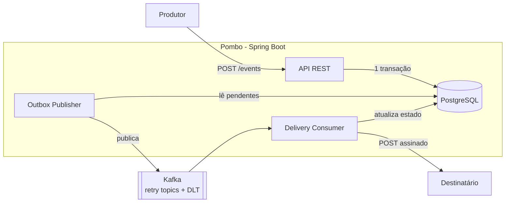
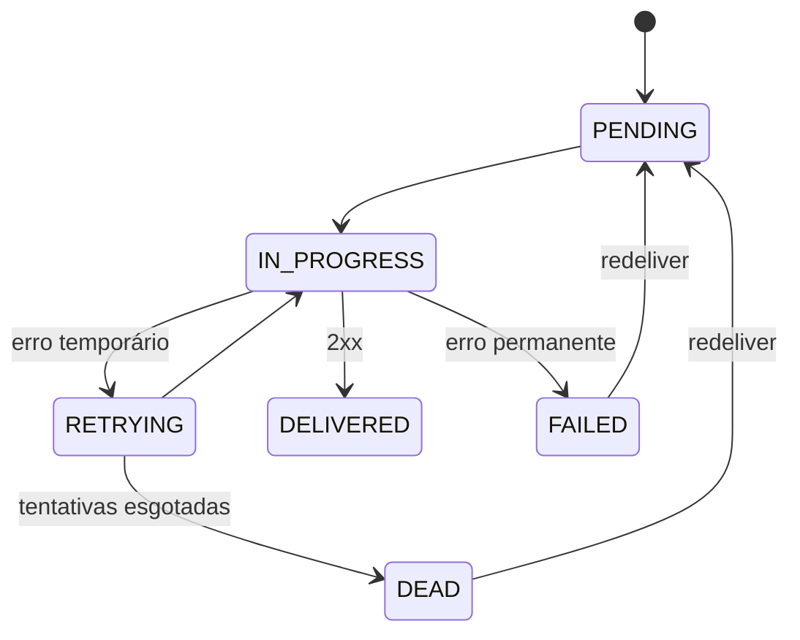

<div align="center">

# 🕊️ Pombo

**Serviço de entrega confiável de webhooks**
Receba eventos pela API e entregue-os a qualquer URL com assinatura HMAC, retentativas controladas, Dead Letter Topic e histórico auditável.


[](https://github.com/SEU_USUARIO/pombo/actions/workflows/ci.yml)


</div>

---

## O problema

Notificar outro sistema via webhook parece simples, até que o destino fica fora do ar, responde devagar ou recebe a mesma notificação duas vezes. Fazer a chamada HTTP dentro da requisição da API ainda acopla a sua disponibilidade à do cliente.

O **Pombo** resolve isso de ponta a ponta:

- ✅ Aceita o evento rapidamente (`202 Accepted`) e entrega **de forma assíncrona**
- ✅ **Retentativas** com backoff exponencial e limite definido
- ✅ **Dead Letter Topic** para entregas esgotadas e **reenvio manual**
- ✅ **Assinatura HMAC-SHA256** em cada entrega, com proteção anti-replay
- ✅ **Histórico completo** de tentativas (status HTTP, duração, erro)
- ✅ **Transactional Outbox**: nenhum evento aceito é perdido entre o banco e o Kafka
- ✅ Proteção contra **SSRF** no cadastro e na entrega

> Garantia de entrega: **at-least-once**. O destinatário deve deduplicar por `X-Pombo-Delivery-Id`, que é estável em todas as tentativas.

## Como funciona



1. `POST /events` grava **evento, entregas e mensagens de outbox na mesma transação** e responde `202`.
2. O publicador do outbox envia as mensagens ao Kafka (`acks=all`, producer idempotente).
3. O consumidor assume a entrega com uma transição de estado condicional (idempotência), faz o `POST` assinado e registra a tentativa.
4. Erro temporário → retry topic com backoff. Erro permanente (`4xx`) → `FAILED`. Tentativas esgotadas → `DEAD` + DLT.

### Estados de uma entrega



## Stack

| Área | Tecnologias |
|---|---|
| Backend | Java 21, Spring Boot, Spring Web, Spring Data JPA, Spring Security (JWT), Bean Validation |
| Dados | PostgreSQL, Flyway |
| Mensageria | Apache Kafka, Spring for Apache Kafka (`@RetryableTopic`, DLT) |
| Qualidade | JUnit 5, Mockito, Testcontainers, WireMock, ArchUnit |
| Observabilidade | Actuator, Micrometer, Prometheus, Grafana, logs JSON |
| Infra | Docker, Docker Compose, Kubernetes (Kind), Terraform, AWS, GitHub Actions (OIDC) |

## Executando localmente

**Pré-requisitos:** Docker 24+ e Docker Compose v2.

```bash
git clone https://github.com/SEU_USUARIO/pombo.git
cd pombo
cp .env.example .env          # defina DB_PASSWORD, JWT_SECRET e SECRETS_ENC_KEY
docker compose up -d --build
```

A API sobe em `http://localhost:8080` e a documentação interativa em `http://localhost:8080/swagger-ui.html`.

Para subir também um destinatário de teste e o Kafka UI:

```bash
docker compose --profile tools up -d
```

Para encerrar:

```bash
docker compose down        # mantém os dados
docker compose down -v     # apaga os volumes
```

## Experimente o fluxo completo

```bash
# 1. Criar conta e obter token
curl -s -X POST localhost:8080/api/v1/auth/register \
  -H 'Content-Type: application/json' \
  -d '{"email":"ana@exemplo.com","password":"uma-senha-forte-123"}'

TOKEN=$(curl -s -X POST localhost:8080/api/v1/auth/login \
  -H 'Content-Type: application/json' \
  -d '{"email":"ana@exemplo.com","password":"uma-senha-forte-123"}' | jq -r .accessToken)

# 2. Cadastrar um destino (o segredo é exibido apenas nesta resposta)
curl -s -X POST localhost:8080/api/v1/endpoints \
  -H "Authorization: Bearer $TOKEN" -H 'Content-Type: application/json' \
  -d '{"url":"http://receiver:8080/hook","eventTypes":["*"]}'

# 3. Enviar um evento
curl -s -X POST localhost:8080/api/v1/events \
  -H "Authorization: Bearer $TOKEN" -H 'Content-Type: application/json' \
  -H 'Idempotency-Key: pedido-1042' \
  -d '{"type":"pedido.pago","payload":{"pedidoId":1042,"valor":"199.90"}}'

# 4. Consultar a entrega e suas tentativas
curl -s -H "Authorization: Bearer $TOKEN" localhost:8080/api/v1/deliveries/<DELIVERY_ID> | jq
```

> `http` e destinos de rede interna só são aceitos no perfil `local`. Em produção, apenas `https` e IPs públicos.

### Verificando a assinatura (lado do destinatário)

```
X-Pombo-Signature: v1=<hex>
hex = HMAC_SHA256(secret, X-Pombo-Timestamp + "." + corpoBruto)
```

Rejeite timestamps com mais de 5 minutos de diferença e deduplique por `X-Pombo-Delivery-Id`.

## API

| Método | Caminho | Descrição |
|---|---|---|
| POST | `/api/v1/auth/register` · `/auth/login` | Cadastro e login (JWT, 15 min) |
| POST/GET/PATCH | `/api/v1/endpoints` | Gerenciar destinos |
| POST | `/api/v1/endpoints/{id}/rotate-secret` | Rotacionar segredo de assinatura |
| POST | `/api/v1/events` | Enviar evento (`202`, suporta `Idempotency-Key`) |
| GET | `/api/v1/events` · `/events/{id}` | Consultar eventos |
| GET | `/api/v1/deliveries` · `/deliveries/{id}` | Entregas e histórico de tentativas |
| POST | `/api/v1/deliveries/{id}/redeliver` | Reenviar entrega `FAILED`/`DEAD` |
| GET | `/api/v1/admin/stats` | Indicadores operacionais (`ADMIN`) |

Erros seguem o padrão **RFC 7807** (`application/problem+json`) com `requestId` para correlação com os logs. Contratos completos e exemplos em [`docs/SPEC.md`](docs/SPEC.md#8-api-rest).

## Testes

```bash
./mvnw test      # unitários
./mvnw verify    # + integração (Testcontainers; requer Docker)
```

Cobertura focada em fluxos críticos: sucesso, retry até sucesso, `DEAD` com DLT, erro permanente, **mensagem Kafka duplicada**, **Kafka indisponível durante o envio**, isolamento entre usuários e proteção SSRF.

## Kubernetes

Manifests em [`k8s/`](k8s) com startup/liveness/readiness probes, requests/limits e rolling update sem indisponibilidade.

```bash
kind create cluster --name pombo
kind load docker-image pombo:dev --name pombo
kubectl apply -f k8s/
kubectl port-forward svc/pombo 8080:80
```

Decisão importante: a **readiness** considera o PostgreSQL, mas **não o Kafka**. Com o Kafka fora, a API continua aceitando eventos e o outbox acumula. O estado do Kafka é monitorado por métricas e alertas, não por probes. Detalhes e guia de diagnóstico de `OOMKilled` e CPU throttling em [`docs/SPEC.md`](docs/SPEC.md#13-kubernetes-e-recursos-de-cpumemória).

## AWS

| Perfil | Composição | Uso |
|---|---|---|
| **Econômico** | ECR, EC2 com Compose, SSM Parameter Store, CloudWatch, IAM (OIDC) | Demonstração padrão |
| **Completo (efêmero)** | EKS, RDS, MSK, ALB via Terraform | Demonstrações pontuais, seguido de `terraform destroy` |

A infraestrutura é definida em [`terraform/`](terraform). O deploy via GitHub Actions usa **OIDC**, sem chaves AWS permanentes no repositório.

> ⚠️ EKS, MSK, RDS, NAT Gateway e load balancers geram custo mesmo ociosos. Configure AWS Budgets antes do primeiro `apply` e destrua o ambiente completo após o uso.

## Observabilidade

- Logs JSON com `requestId`, `deliveryId` e `attempt`
- `/actuator/health/liveness`, `/actuator/health/readiness` e `/actuator/prometheus`
- Métricas: tentativas por resultado, duração das entregas, entregas `DEAD`, mensagens pendentes no outbox e idade da mais antiga, lag do consumidor Kafka
- Dashboard Grafana opcional em [`observability/`](observability)

Procedimento para investigar uma entrega "aceita mas não concluída" em [`docs/runbook.md`](docs/runbook.md).

## Estrutura do repositório

```
pombo/
├── src/main/java/com/pombo/   auth · user · endpoint · event · delivery · outbox · shared
├── src/main/resources/db/migration/
├── src/test/
├── k8s/            manifests Kubernetes
├── terraform/      infraestrutura AWS
├── observability/  Prometheus e Grafana
├── load-test/      cenários k6
├── docs/           SPEC.md · runbook.md · cost-notes.md
├── .github/workflows/   ci.yml · release.yml
├── Dockerfile
└── docker-compose.yml
```

## Documentação

| Documento | Conteúdo |
|---|---|
| [`docs/SPEC.md`](docs/SPEC.md) | Especificação completa: requisitos, regras de negócio, modelo de dados, estratégia Kafka, segurança, CI/CD, roadmap |
| [`docs/runbook.md`](docs/runbook.md) | Troubleshooting e comandos de diagnóstico |
| [`docs/cost-notes.md`](docs/cost-notes.md) | Premissas de custo na AWS |

## Status e roadmap

- [ ] 1. Domínio, estrutura inicial e migrations
- [ ] 2. API REST e persistência
- [ ] 3. Segurança (JWT, SSRF, cifragem de segredos)
- [ ] 4. Kafka: outbox, consumidor, retry e DLT
- [ ] 5. Testes e cenários de falha (**MVP**)
- [ ] 6. Docker e ambiente local
- [ ] 7. Health checks e observabilidade
- [ ] 8. CI/CD
- [ ] 9. Kubernetes local
- [ ] 10. AWS e Terraform
- [ ] 11. Testes de carga e documentação final

## Limitações conhecidas

- Entrega **at-least-once**, sem ordenação entre eventos de um mesmo destino.
- Kafka e PostgreSQL de nó único em desenvolvimento e no perfil econômico.
- Sem multi-tenancy, rate limiting por destino ou revogação de JWT antes da expiração.

Lista completa e evoluções planejadas em [`docs/SPEC.md`](docs/SPEC.md#22-limitações-conhecidas).

## Licença

Distribuído sob a licença MIT. Veja [`LICENSE`](LICENSE).
